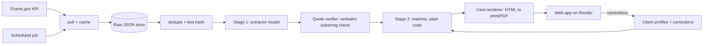

# Grant Fine Print: PRD, MVP and Workflow

**Challenge:** Hacktoberfest Open-Source AI Challenge, Week 2, theme "Side Hustle" (build something someone would actually pay for).
**Deadline:** Oct 18, 2026, 11:59 PM PDT, which is Oct 19, 12:29 PM IST. Target publishing a complete post by about 6 AM IST on Oct 19, leaving a buffer.
**Required tags:** `#devchallenge`, `#hf26challenge`. Use the Week 2 submission template.
**Builder:** solo.

---

## 1. One-line pitch

A weekly **one-page fine-print card** for freelance grant writers. It reads the free-text eligibility rules in new federal grant opportunities, checks them against each client's profile, and tells the writer which grants to pursue, which to rule out (with the exact sentence that rules them out), and which need a human read.

## 2. The problem

Grants.gov lets users filter by applicant-eligibility code, but some opportunities use an "Others" code that says to read a free-text eligibility field. The real rules live in that text: who may apply, where they must be based, and who is excluded. A code filter can't read it.

That leaves a freelance grant writer with two bad options:
- Trust the code filter and miss grants that are open to their client, or chase grants their client can't win.
- Read the full eligibility text of every new opportunity for every client, every week.

**Why the official filter doesn't solve this** (put this in one sentence near the top of the post): the facet filters on the code, and for "Others" the code tells you nothing.

## 3. Buyer and value

**Buyer: freelance grant writers** (one person, not "nonprofits and small businesses"). They manage several clients, bill by project or retainer, and lose paid time on eligibility screening.

**What they'd pay for:** hours saved screening, plus fewer wasted drafts. The price is derived from measured cost per weekly run (section 12), not guessed.

**Not for:** applicants without a writer, legal or compliance advice, or writing the application itself.

## 4. Principles

1. **Quote or abstain.** NOT ELIGIBLE is only allowed when the system can quote the exact disqualifying sentence from the source text. Anything inferred becomes CHECK. This is enforced in code, not by prompting.
2. **Measure before building the story.** The post leads with numbers from the real data.
3. **Labels first, frozen.** The test labels are written before any model output is seen and committed to git before any evaluation runs.
4. **Publish negative results.** If the fine-tuned model loses to the prompted baseline, say so.
5. **Not advice.** Grants.gov and the linked announcement are authoritative. Every card says to confirm in the original notice.

## 5. Data source

**Grants.gov public API** (`search2` for lists, `fetchOpportunity` for details). Both are documented as needing no authentication.

Fields needed per opportunity (confirm exact names against one live response before coding):
- id, opportunity number, title, agency, status, open and close dates
- award floor and ceiling, estimated funding, cost sharing
- applicant-type codes, and the free-text "additional information on eligibility"
- synopsis (description)
- link to the Grants.gov page

**Verify before relying on them** (these come from a briefing note, not from a live check in this document):
- The exact field that holds the free-text eligibility description.
- The label and code number of the "Others" applicant type.
- The API's rate limit (be polite and add delays and caching regardless).
- The base URLs, from Grants.gov's own API documentation.

**Handling rules**
- Cache raw JSON to disk, keyed by id plus a hash of the text. Never re-fetch what you already have.
- Record the pull date and counts. Opportunities change, so the post must state the pull date.
- Do not republish agency contact emails or phone numbers on cards.
- Check Grants.gov's terms of use and cite it in the post.

## 6. Product definition

### 6.1 Client profile (set once per client)
Fields: organisation type (nonprofit, for-profit, university, tribal, government, individual), US state, whether US-based, size band if relevant (small business), focus keywords. Stored as JSON. Corrections are stored alongside (section 6.4).

### 6.2 Verdicts

| Verdict | Condition |
|---|---|
| **LIKELY ELIGIBLE** | every extracted hard condition is satisfied by the profile, and no unknown hard condition remains |
| **NOT ELIGIBLE** | at least one hard condition of a known type conflicts with the profile **and** has a verbatim quote verified in the source text |
| **CHECK** | everything else, shown with the exact sentences to read |

Every card also shows: deadline, award range, agency, link, and the line "Confirm in the original notice."

### 6.3 How it decides (two stages)

**Stage 1: extract conditions (the model).** For each opportunity, once and independent of any client, a small fine-tuned open model reads the eligibility text and synopsis and returns structured conditions:

```json
{
  "conditions": [
    {"type": "org_type", "polarity": "required", "value": "U.S.-based commercial organization",
     "quote": "<verbatim sentence from the source>"},
    {"type": "location", "polarity": "excluded", "value": "organisations outside the U.S.",
     "quote": "<verbatim sentence>"}
  ]
}
```
Condition types: `org_type`, `location`, `citizenship_or_residency`, `size`, `prior_award_or_status`, `partnership_required`, `cost_share`, `other`.

**Stage 2: match (plain code).** The code compares conditions with a client's profile.
- Types the code can evaluate directly (`org_type`, `location`, size): compare with the profile.
- Everything else (`prior_award_or_status`, `partnership_required`, `other`, and anything unparsable): CHECK.
- NOT ELIGIBLE requires a **verified quote**: the quote, after whitespace normalisation, must be a substring of the source text. If not, the condition is dropped and the result becomes CHECK.

Because stage 1 runs once per opportunity (cached by text hash), the model cost does not grow with the number of clients, and every verdict is explainable by pointing at the sentence.

### 6.4 Corrections
Each card has "this is wrong". The writer picks the right verdict and adds an optional note. The correction is stored per profile and per opportunity, applied as an override on later runs, and added to the evaluation log. This is the MVP version of memory (a simple table, no external service needed).

### 6.5 Output
- **Printed card (the differentiator):** one A4 or Letter page per client, grouped by verdict, designed to print cleanly. Each NOT ELIGIBLE row shows the quoted sentence. Each CHECK row says which sentence to read.
- **Web view** of the same card, with the correction buttons.

## 7. The study (the headline numbers)

Run before any modelling. Pull all currently open opportunities, record the pull date and total count.

| Number | Definition | How measured |
|---|---|---|
| **(a)** | opportunities whose **only** applicant type is the "Others" code | a script, minutes |
| **(b)** | opportunities whose codes look permissive but whose free text adds a hard disqualifier | a **hand-labelled random sample** (for example 100 of the permissive-code opportunities), reported as "x of 100" |
| **(c)** | how many a simple keyword search for exclusion words would catch | regex on the same sample, to show what a keyword filter misses |

Report **raw counts**, not only percentages ("1 of 62", not "1.6%"). (b) is the stronger story: the filter doesn't just give no answer, it gives a misleading one.

State the definition of "hard disqualifier" in the post: a sentence that says who may not apply, or that restricts applicants by location, organisation type, status or size.

## 8. Evaluation design

### 8.1 Test set
- **5 to 6 client profiles** written by you, disclosed as constructed profiles (for example a rural-health 501(c)(3), a small for-profit, a state university, a tribal organisation, a non-US organisation). If a real grant writer shares a profile with consent, use it as one of them.
- **About 25 opportunities** selected at random (stratified so that some have the "Others" code and some have permissive codes).
- That gives **about 125 opportunity-and-profile pairs.**
- Hand-label each pair with the **true verdict** (ELIGIBLE, NOT_ELIGIBLE or CHECK, meaning genuinely ambiguous after reading the full notice). For each NOT_ELIGIBLE pair, mark the disqualifying sentence.
- Label using a written rubric (section 8.5).

### 8.2 Freeze rule
Commit `data/labels/test_labels.csv` and tag the commit (for example `labels-frozen`) **before running any model on the test set.** No relabelling after seeing output. If you find a rubric mistake, fix it in a visible, dated commit and say so in the post.

### 8.3 Training data (separate from the test set)
- Use opportunities that are **not in the test set**, including older or closed ones if the API exposes them.
- Remove **near-duplicates** (recurring annual announcements with almost identical text) between training and test, by comparing normalised text hashes or similarity, so no near-copy leaks across.
- Training targets are condition extractions with verbatim quotes. Produce them with a larger open model, then **hand-check a sample** (say 50) and fix errors. Disclose that the training labels are model-assisted and the test labels are fully hand-made.
- Keep the training set size and the check results in the post.

### 8.4 Systems compared (same test pairs)
1. **Code-only baseline:** match the profile's organisation type to the applicant-type codes; "Others" becomes CHECK.
2. **Prompted base model:** the same small base model with only a prompt, using the same two-stage design.
3. **Fine-tuned model (Tinker):** the same base model, fine-tuned on the training set.
4. *(Optional)* **A large open model, prompted,** as an upper reference.

### 8.5 Metrics
| Metric | Definition |
|---|---|
| **Missed-grant rate (primary)** | pairs whose true label is ELIGIBLE but predicted NOT ELIGIBLE, written as "k of N" |
| **Soft miss** | true label CHECK but predicted NOT ELIGIBLE, as "k of N" |
| **Human-read share** | share of cards the system marks CHECK (what a writer still has to read) |
| **Verdict accuracy** and confusion matrix | three-way agreement with the hand labels |
| **Quote validity** | share of model-proposed disqualifier quotes that are verbatim substrings, measured **before** code enforcement |
| **Quote correctness** | among NOT ELIGIBLE verdicts, share where the quoted sentence really is a disqualifier |
| **Latency** | median and 95th percentile per opportunity |
| **Cost** | cost per 1,000 opportunities, using each provider's list price and stating the date |

The story is the **pair**: missed-grant rate (as close to zero as possible) and human-read share (the honest cost of that safety).

**Labelling rubric (write this down before labelling):**
- ELIGIBLE: the profile clearly meets every stated applicant requirement.
- NOT_ELIGIBLE: at least one stated requirement or exclusion clearly rules the profile out.
- CHECK: a requirement depends on facts not in the profile, or the text is genuinely ambiguous.
- When unsure, label CHECK and note why.

## 9. MVP scope

### In scope (must ship)
1. `pull` script: fetch, cache and de-duplicate opportunities.
2. `study` script: numbers (a) and (c), plus the sample sheet for (b).
3. Labelling files and the frozen test labels.
4. Stage 1 extractor with a prompted baseline and a Tinker fine-tune.
5. Stage 2 matcher with quote-or-abstain enforcement.
6. `eval` script that writes `results/eval.json` and charts for the three systems.
7. Card renderer that produces a printable page per profile.
8. Minimal web app: profile form, run button, card view, correction buttons.
9. Deployment on Render (web service, plus a scheduled job to pull and rebuild weekly).

### Out of scope
Accounts, payments, email sending, writing the grant application, non-federal grants, Temporal, a database cluster, and any claim of legal advice.

### Cut order if time runs short
1. Temporal (describe the durable version as next step)
2. Backboard (the corrections table covers the MVP)
3. Sentry and the `.tech` domain
4. Web-app polish (keep the CLI and the printed card)
5. Optional large-model reference run

**Never cut:** the study, the frozen labels, the three-way comparison, the quote-or-abstain rule and the printed card.

## 10. Sponsors

| Sponsor | Job | Priority |
|---|---|---|
| **Tinker** | fine-tune the stage-1 extractor and compare with the prompted baseline | **Must** |
| **Render** | host the web service and run the weekly pull and card build as a scheduled job | **Must** |
| **Entire** | record and embed your build sessions | Cheap, set up now |
| **Backboard** | per-client memory and corrections | Cut-tier 2 |
| **Temporal** | durable weekly run with retries | Cut-tier 1 (next step) |
| **Sentry** | traces of the extraction calls | Optional |
| **.tech domain** | a live address for the app | Optional |

Claim free credits (Tinker, Render, Backboard, and a `.tech` domain) at hacktoberfest.com/my/promos. Check Tinker's docs for supported base models before choosing one.

Mention only the sponsors you actually used, and give each one honest space in the post.

## 11. Architecture



**Suggested layout**
```
grant-fine-print/
  data/raw/            cached API JSON
  data/labels/         test_labels.csv (frozen), train_labels.jsonl, rubric.md
  src/pull.py          fetch and cache
  src/study.py         headline numbers
  src/extract.py       stage 1 (prompted and fine-tuned backends)
  src/verify.py        quote verification
  src/match.py         stage 2
  src/cards.py         card renderer
  src/eval.py          metrics and charts
  app/                 web app
  results/             eval.json, study.json, charts
  config.yaml          models, thresholds, code mappings
```

**Config:** keep the applicant-code-to-profile mapping, model names and thresholds in `config.yaml`. Build the code mapping from Grants.gov's own code list, not from memory.

## 12. Economics (for "someone would pay")

- **Cost per weekly run** = (tokens per opportunity × opportunities × price) for stage 1 only, since stage 2 is free. Show cost per 1,000 opportunities and per client per week.
- **Price** = decided after the cost is measured and after the first user's reaction. State how you reasoned about it, and don't invent a figure.
- **Value for the buyer** = time saved screening (ask the first user how long they spend per week now).

## 13. Workflows

### 13.1 Weekly product workflow
1. Scheduled job pulls new and changed opportunities, using the hash to find changes.
2. New or changed texts go to stage 1. Unchanged texts reuse the cache.
3. The verifier drops any condition whose quote is not a verbatim substring.
4. The matcher produces verdicts for each profile and applies corrections.
5. The card renderer writes one printable page per profile.
6. The writer opens the card, prints it, and uses "this is wrong" where needed.

### 13.2 Build workflow (hour budget)

Hour 0 is when you start. Plan roughly 30 working hours. The post gets a full block.

| Block | Hours | Output |
|---|---|---|
| **1. Pull and study** | 0 to 3 | cached data, numbers (a) and (c), sample sheet for (b) |
| **2. Labelling (labels first)** | 3 to 7 | rubric, 5 to 6 profiles, about 125 labelled pairs, the (b) sample labelled; **commit and tag the frozen labels** |
| **3. Extractor and matcher** | 7 to 12 | prompted baseline, quote verifier, matcher, training set assembled and checked |
| **4. Fine-tune and evaluation** | 12 to 17 | Tinker fine-tune, three-way comparison, `results/eval.json`, charts, a real wrong example saved |
| **5. Card and app** | 17 to 22 | printable card, minimal web app, correction buttons |
| **6. Deploy and first user** | 22 to 24 | Render service and scheduled job live; send a sample card to a real grant writer |
| **7. Write-up** | 24 to 29 | the post, with figures and the honest limits |
| **8. Buffer and submit** | 29 to 30 | proofread, check links, publish well before the deadline |

Send the first-user message by about hour 20, so a reply can reach the post. If sleeping is needed, protect Blocks 2 and 7.

### 13.3 Labelling workflow
1. Write the rubric. Choose the profiles. Pick the test opportunities with a random seed you record.
2. Read each opportunity's full text and label the profiles before running any model.
3. Mark the disqualifying sentence for every NOT_ELIGIBLE label.
4. Commit and tag. From now on, the test labels do not change without a visible fix commit.

### 13.4 Evaluation workflow
1. Run all systems on the frozen test pairs with fixed settings, and save raw outputs.
2. Compute metrics with `eval.py` (never by hand).
3. Save the confusion matrices, the "k of N" counts, the latency and cost table.
4. Keep at least one wrong card, with the reason.

### 13.5 First-user workflow
1. Find one or two freelance grant writers (professional groups, forums that allow it, or direct introductions). Follow each community's rules and don't spam.
2. Message them with a real sample card for a profile like theirs, and ask three questions: how long does screening take you now, would you use this weekly, what would you pay and why.
3. Record the exact answers. If nobody replies, say so in the post.

Sample message:
> Hi, I'm building a small tool that reads the eligibility fine print in federal grant notices and flags which ones fit a client, quoting the sentence that rules a grant out. I made a sample one-page card for [type of client]. Would you be willing to look at it and tell me whether it would save you time, and what's missing? No charge, and I'd value your honest take.

### 13.6 Writing workflow
Write the post in the same order as the data: study, then method, then evaluation, then card, then first user, then limits.

## 14. Risks and responses

| Risk | Response |
|---|---|
| API field names or codes differ from assumptions | check one live response first, adjust config, note changes |
| Fine-tune doesn't beat the prompted baseline | publish the result and explain the reason |
| Labelling takes longer than planned | reduce to fewer opportunities per profile, but keep the freeze rule |
| Train and test leakage from recurring announcements | dedupe by text hash and similarity before splitting |
| Wrong NOT ELIGIBLE hides a winnable grant | quote-or-abstain, verified substrings, report the miss rate |
| No first user in time | say so, and report the feedback you did get |
| Eligibility text changes after you pull | record pull date and tell users to confirm in the notice |
| Time overrun | use the cut order in section 9 |

## 15. Honest limits (state in the post)

- US federal grants from Grants.gov only.
- Constructed client profiles in the test set (unless a real one was used).
- Small test set, so results come with counts and not tight percentages.
- Training labels are model-assisted. Test labels are hand-made.
- This is a screening aid, not legal or grant advice. Always confirm in the original notice.
- Opportunities and amendments change after the pull date.

## 16. Post outline (Writing Quality is weighted most)

1. **Title with a number**, such as "N federal grants hide their real eligibility rules in free text. Here is what a code filter misses." (use your real number)
2. **Hook:** one real opportunity where the code says yes and the fine print says no, with the quoted sentence.
3. **Why the official filter doesn't solve it** (one sentence).
4. **The study:** numbers (a), (b) and (c), with raw counts and the pull date.
5. **The product:** the card (show a real one), the verdicts, quote-or-abstain.
6. **How it works:** the two stages and why the model only extracts.
7. **Evaluation:** frozen labels, three systems, the missed-grant rate and the human-read share, the cost table, the confusion matrices.
8. **A wrong card, shown on purpose.**
9. **Why open mattered:** a small open model is cheap enough for the business to work, can be fine-tuned on this niche, and keeps client profiles on infrastructure the writer controls.
10. **Sponsors:** one honest paragraph for each one actually used.
11. **First user:** what they said, what they would pay, what they asked for next.
12. **Limits and what's next** (Temporal for a durable run, more grant sources, email delivery).
13. **Credits and the agent session.**

## 17. Acceptance checklist

- [ ] Raw data cached with the pull date and counts recorded
- [ ] Study numbers (a), (b) and (c) computed, with raw counts
- [ ] Rubric written before labelling
- [ ] Test labels committed and tagged before any evaluation
- [ ] No test opportunity (or near-duplicate) appears in the training data
- [ ] Quote verifier rejects non-verbatim quotes
- [ ] NOT ELIGIBLE is impossible without a verified quote
- [ ] Three systems evaluated on the same frozen pairs
- [ ] Missed-grant rate and human-read share reported as "k of N"
- [ ] Latency and cost table with dates and sources
- [ ] A printed card exists, with at least one real example and one wrong one
- [ ] Corrections are saved and applied on the next run
- [ ] App live on Render with a scheduled job
- [ ] One real writer received a sample card
- [ ] Post uses the Week 2 template and required tags
- [ ] Only sponsors actually used are named
- [ ] Published before the deadline